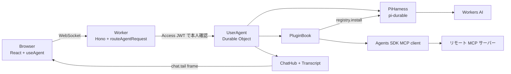

# Plugin Agent Chat

ユーザーが自分の MCP サーバーと Agent Skills (`SKILL.md`) をプラグインとして登録できるエージェントチャットです。Cloudflare Workers 上で動き、エージェント本体は Agents SDK の `PiHarness` が Durable Object の中で動かす Pi Durable です。UI は [Beautiful UI](https://www.beautifului.dev) のコンポーネントを実データ駆動に書き換えて使っています。

## 構成

ユーザー 1 人につき `UserAgent` Durable Object が 1 つあります。プラグイン、会話履歴、MCP 接続、OAuth トークンはすべてその Durable Object の SQLite に入ります。



- `src/server/agent.ts` は Durable Object 本体です。`@callable` メソッドがブラウザからの操作口になります。
- `src/server/plugins/book.ts` はプラグインの保存と、有効なプラグインを pi の registry に反映する処理を持ちます。MCP のツール一覧はキャッシュするので、コールドスタート直後でもネットワークを待たずにツールが揃います。
- `src/server/chat/transcript.ts` は pi のイベントを画面用の `Turn` に畳み込む純粋な reducer です。
- `src/shared/protocol.ts` はブラウザとサーバーの契約です。pi や SDK の型はここに出しません。
- `src/client/` は React の UI です。`use-workspace.ts` が接続と状態をまとめます。

## ローカルで動かす

Workers AI のバインディングはローカルで再現できないので、開発中も Cloudflare 上のモデルを呼びます。少額の利用料がかかります。

1. 依存を入れます。

   ```sh
   pnpm install
   ```

2. 開発用の認証モードを有効にします。`AUTH_MODE=dev` では全リクエストが 1 人のユーザー `u-dev` として扱われます。

   ```sh
   cp .dev.vars.example .dev.vars
   ```

3. Cloudflare にログインします。

   ```sh
   npx wrangler login
   ```

4. 開発サーバーを起動して `http://localhost:5173` を開きます。

   ```sh
   pnpm dev
   ```

ブラウザは secure context (`localhost` か `https://`) で開いてください。Agents SDK のクライアントは `crypto.randomUUID` を使うので、`http://` で別ホストから開くと接続できません。

## デプロイする

本番では Cloudflare Access でログインしたユーザーごとに Durable Object が分かれます。Worker は `Cf-Access-Jwt-Assertion` を検証し、`iss` と `sub` から Durable Object 名を作ります。

1. Zero Trust で Self-hosted の Access アプリケーションを作り、Worker のホスト名を保護します。`workers.dev` のルートを使わない場合は無効にします。
2. `wrangler.jsonc` の `vars` に `ACCESS_TEAM_DOMAIN` (例 `myteam.cloudflareaccess.com`) と `ACCESS_AUD` (アプリケーションの AUD タグ) を設定します。`AUTH_MODE` は `access` のままにします。
3. デプロイします。

   ```sh
   pnpm run deploy
   ```

既定のモデルは `@cf/zai-org/glm-4.7-flash` です。Workers Free プランで tool calling ができることを確認しています。有料プランで別のモデルを使うときは `MODEL_ID` を変えます。既存の会話も次の起動時に新しいモデルへ切り替わります。

## プラグインを追加する

サイドバーの **Plugins** から追加します。追加・無効化・削除は、エージェントの次のステップから反映されます。

- **MCP server**: 名前と URL を入れます。API キーが必要なサーバーは **Header** でヘッダーを足します。ヘッダーの値は Durable Object の中にだけ保存され、画面には名前しか戻りません。OAuth が必要なサーバーでは **Authorize** リンクが出るので、別タブで認可してください。
- **Skill (paste)**: `name` と `description` の frontmatter を持つ `SKILL.md` を貼り付けます。
- **Skill (URL)**: `SKILL.md` の https URL を入れます。GitHub の `blob` URL は raw に読み替えます。

チャット欄で `/` を打つと有効なスキル、`@` を打つとプラグインの一覧と有効・無効の切り替えが出ます。

## 動作を確認する

型検査とビルドです。

```sh
pnpm typecheck
pnpm build
```

`scripts/smoke.mjs` は起動中の開発サーバーに対して、プラグインの登録、MCP ツールの実行、スキルの読み込み、ヘッダー値とURLクエリがブラウザ向けフレームに出ないことを確かめます。開発サーバーを再起動したあとに `--after-restart` を付けて流すと、プラグインと履歴がコールドスタートを越えて残ることを確かめます。

```sh
HOST=127.0.0.1:5173 node scripts/smoke.mjs
HOST=127.0.0.1:5173 node scripts/smoke.mjs --after-restart
```

## 制約

- MCP のヘッダー値と OAuth トークンは、Agents SDK が Durable Object の SQLite に平文で保存します。暗号化はしていません。
- スキルは `SKILL.md` 本文だけを扱います。`references/` や `scripts/` などの付属ファイルは読み込みません。
- ツール実行前の承認フローはありません。
- MCP のツール呼び出しはクラッシュ後に再実行しません。中断されたツールはエラーとしてモデルに返ります。
- UI は Beautiful UI のレジストリ `https://www.beautifului.dev/r/<name>.json` から取り込んだコンポーネントを改変したものです。ライセンス表記は `THIRD_PARTY_NOTICES.md` にあります。
